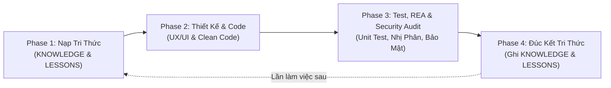

# Senior Dev Workflow: Full-Cycle Engineering, Reverse Test & Security Audit

Workflow chuẩn mực kết hợp 5 năng lực cốt lõi:
1. **Quản lý tri thức Codebase (`code-knowledge-keeper`):** Đọc và cập nhật tài liệu sống `KNOWLEDGE.md`.
2. **Kinh nghiệm & Phòng ngừa lỗi (`code-mistake-lessons`):** Đọc và cập nhật quy tắc phòng ngừa trong `LESSONS.md`.
3. **Thiết kế & Lập trình chuẩn Senior (`senior-design-engineer`):** Thiết kế UX/UI chỉn chu, code tối giản, tự phản biện trước khi giao.
4. **Kiểm thử sâu & Dịch ngược nhị phân (`reverse-engineer-anything`):** Bóc tách tệp nhị phân, kiểm tra linkage, symbols, IAT, memory và debug crash ở mức máy.
5. **Kiểm toán bảo mật & Săn lỗi (`security-bug-auditor`):** Truy vết bề mặt tấn công, luồng dữ liệu nguồn -> đích, lỗi logic/edge-case, phân loại mức độ nghiêm trọng và đề xuất code vá cụ thể + hardening checklist.

---

## 🔄 Vòng lặp 4 Giai đoạn (The 4-Phase Lifecycle)



---

## 📋 Chi tiết từng giai đoạn

### Giai đoạn 1: Nạp tri thức & Bài học cũ (Context & Ingestion)
*Mục tiêu: Không lặp lại sai lầm trong quá khứ và không tốn công khám phá lại kiến trúc.*

1. **Đọc `LESSONS.md`:** Rà soát các quy tắc phòng ngừa liên quan đến phạm vi sắp làm (ví dụ: quy ước linker, cờ compiler, Unicode boundaries).
2. **Đọc `KNOWLEDGE.md`:** Nắm bắt các quy ước ngầm, kiến trúc module, các bẫy tiềm ẩn (traps), invariants và các lệnh chạy chuẩn.
3. **Thu thập sự kiện:** Kiểm tra context của caller, side-effects, component dùng chung trước khi can thiệp.

---

### Giai đoạn 2: Thiết kế UX/UI & Viết Clean Code (Senior Design Engineering)
*Mục tiêu: Giải đúng bài toán, giao diện chuẩn mực, code tối giản và tự phản biện.*

1. **Thiết kế UX/UI (nếu có giao diện):**
   - Một mục tiêu, một điểm nhấn chính.
   - Phân cấp thị giác rõ ràng, thang khoảng cách 4/8px.
   - Đảm bảo độ tương phản màu sắc WCAG (≥ 4.5:1).
   - Đủ các trạng thái: hover, focus, active, disabled, loading, empty, error.
2. **Viết Clean Code:**
   - Thay đổi tối thiểu đúng trọng tâm, không tạo abstraction thừa thãi.
   - Dùng Design Tokens / Constants thay vì magic numbers và hardcode màu.
   - Hàm/component nhỏ, một trách nhiệm duy nhất.
3. **Tự phản biện trước khi giao (Self-Critique):**
   - Tự soi xét từng quyết định thiết kế và thay đổi code: ✅ **Giữ**, ⬇️ **Thu hẹp**, ❌ **Bỏ**.

---

### Giai đoạn 3: Kiểm thử sâu, Dịch ngược & Kiểm toán bảo mật (Deep Test, REA & Security Audit)
*Mục tiêu: Đảm bảo phần mềm không chỉ chạy mà còn vững trước lỗ hổng bảo mật, lỗi logic biên và vận hành chuẩn ở cấp độ nhị phân.*

1. **Chạy Unit Tests & Integration Tests:**
   - Đảm bảo 100% test pass.
   - Thêm test case cho edge cases (chuỗi rỗng, Unicode phức tạp, ranh giới mảng).
2. **Kiểm toán bảo mật & Săn lỗi (`security-bug-auditor`):**
   - **Xác định stack & Attack Surface:** Liệt kê các điểm dữ liệu ngoài đi vào hệ thống (file, input người dùng, IPC, CLI args, HTTP, DB).
   - **Phân tích đa tầng (phòng thủ):**
     - Injection/Execution (SQLi, Command Injection, XSS, Unsafe deserialization, Path Traversal).
     - Auth/Access Control & Cấu hình/Dữ liệu nhạy cảm (hardcoded secrets, log lộ thông tin, CORS/CSP lỏng).
     - Đặc thù ngôn ngữ (Rust/C/C++: `unsafe`, overflow, `.unwrap()`/panic trên input chưa kiểm tra, FFI; JS/TS: `dangerouslySetInnerHTML`, prototype pollution, race async).
     - Lỗi logic & edge-case (TOCTOU, off-by-one, tràn số, rò rỉ tài nguyên).
   - **Báo cáo & Vá theo mức độ (`Critical` → `High` → `Medium` → `Low`):** Chỉ rõ vị trí, nguyên nhân gốc, mã vá an toàn giữ nguyên chức năng và checklist gia cố (hardening checklist). *Không tạo payload khai thác hoặc tấn công mục tiêu bên ngoài.*
3. **Kiểm tra nhị phân (Binary & Linkage Inspection qua công cụ REA):**
   - **Linkage & Imports:** Sử dụng `objdump -p`, `dumpbin` hoặc REA tools kiểm tra bảng Import (IAT), đảm bảo không bị thiếu phụ thuộc, đụng độ runtime (như MSVCRT vs UCRT), hoặc un-relocated symbols.
   - **Symbols & Sections:** Kiểm tra section alignment (`.text`, `.pdata`, `.idata`), đảm bảo bảng ngoại lệ (SEH/DWARF) được tạo đúng quy chuẩn.
4. **Chẩn đoán sự cố Crash (nếu gặp lỗi bộ nhớ / SIGSEGV / 0xC0000005):**
   - Dùng `gdb` / `lldb` hoặc lệnh dịch ngược để phân tích Call Stack, Register State (`rip`, `rsp`, `rax`) và Disassembly tại thời điểm crash.
   - Tìm chính xác lệnh máy gây lỗi thay vì đoán mò.

---

### Giai đoạn 4: Đúc kết tri thức & Cải tiến liên tục (Knowledge Crystallization)
*Mục tiêu: Tự động hóa bộ nhớ dài hạn của dự án.*

1. **Nếu có sai sót hoặc bug/lỗ hổng phát sinh (`code-mistake-lessons`):**
   - Áp dụng kỹ thuật 5 Whys tìm **nguyên nhân gốc**.
   - Viết bài học thành quy tắc kiểm tra được:
     `- [xN] Khi <tình huống> → <hành động> → kiểm tra: <cách kiểm tra>`
   - Cập nhật vào [LESSONS.md](LESSONS.md).
2. **Cập nhật kiến trúc & phát hiện mới (`code-knowledge-keeper`):**
   - Ghi nhận các lệnh mới, bẫy ngầm vừa phát hiện, hoặc quyết định kiến trúc quan trọng vào [KNOWLEDGE.md](KNOWLEDGE.md).
   - Định dạng: `- <điều cần biết> — vì: <lý do> (nguồn: path:dòng; xác minh: YYYY-MM-DD)`.

---

## 🎯 Định dạng báo cáo đầu ra (Output Template)

Mỗi khi hoàn thành một vòng lặp workflow, trình bày kết quả theo mẫu:

```markdown
### 1. Phân tích & Tri thức áp dụng
- **Bài học đã áp dụng:** (từ LESSONS.md)
- **Kiến trúc liên quan:** (từ KNOWLEDGE.md)

### 2. Thiết kế & Thực thi Code
- **Thay đổi chính:** (tóm tắt các file/component)
- **Tự phản biện:** (quyết định đã giữ hoặc loại bỏ)

### 3. Kết quả Kiểm thử, Bảo mật & Dịch ngược
- **Unit Tests:** (số lượng test pass / fail)
- **Kiểm toán bảo mật & Logic (`security-bug-auditor`):** (các phát hiện Critical/High/Medium/Low, phần đã vá & hardening checklist)
- **Phân tích nhị phân (Binary Inspection):** (trạng thái liên kết, DLLs, IAT, symbol integrity)

### 4. Tri thức đúc kết
- **Đã ghi vào LESSONS.md:** (nếu có lỗi vừa sửa)
- **Đã ghi vào KNOWLEDGE.md:** (kiến thức mới về codebase)
```
