# Lộ Trình Phát Triển Tính Năng (`ROADMAP.md`)

> **Sứ mệnh sản phẩm:** Xây dựng trình soạn thảo văn bản tiếng Việt thuần Rust (`egui`/`eframe`) siêu nhẹ (~2MB binary, <30MB RAM, khởi động tức thì <0.2s), mô phỏng bố cục trang giấy in A4 chuẩn xác, gõ tiếng Việt mượt mà tuyệt đối và tương thích định dạng tài liệu văn phòng tiêu chuẩn.

---

## 1. Hiện Trạng Sản Phẩm (Baseline v0.2.0)

Tính đến phiên bản hiện tại, `my_word` đã đạt được nền tảng vững chắc với **43/43 Unit Tests Pass**:

- [x] **Động cơ gõ tiếng Việt kép:** Telex tích hợp thông minh (`Telex: Tự động`) và tương thích 100% với bộ gõ ngoài qua Windows TSF IME (`Telex: Hệ thống`, Unikey, EVKey).
- [x] **Xử lý chuỗi an toàn:** Chuẩn hóa Unicode NFC (`unicode-normalization`), di chuyển con trỏ và xóa ký tự an toàn theo ranh giới cụm ký tự (`unicode-segmentation` grapheme cluster), triệt tiêu hoàn toàn lỗi panic ranh giới byte UTF-8.
- [x] **Rich Text Spans:** Định dạng in đậm ($B$), nghiêng ($I$), gạch chân ($U$), gạch ngang ($S$), cỡ chữ ($8 - 48\text{ pt}$), màu chữ và highlight theo vùng chọn.
- [x] **Công cụ định dạng nhanh:** Sao chép định dạng (Format Painter), Xóa định dạng (Clear Formatting), Thư viện kiểu mẫu nhanh (Preset Styles: Heading 1, 2, Quote, Body).
- [x] **Bố cục trang A4:** Phân trang thời gian thực khổ $595 \times 842\text{ pt}$, lề $72\text{ pt}$, ngắt trang thủ công (`Ctrl+Enter`), căn lề từng đoạn (Trái, Giữa, Phải, Đều 2 bên), thước đo Ruler, thu phóng $60\% - 150\%$.
- [x] **Tìm kiếm & Thay thế:** Hỗ trợ tìm chuỗi tiếng Việt hoa/thường (`Ctrl+F` / `Ctrl+H`), đếm số kết quả, thay thế đơn và thay thế toàn bộ an toàn con trỏ.
- [x] **Lưu trữ & Khôi phục:** Định dạng tệp `.mwd` (`MYWORD_V1`) và `.txt` / `.md`, xuất song song `.doc` (Word HTML), tự động sao lưu Auto-save định kỳ 20 giây vào `%LOCALAPPDATA%\my_word\`.
- [x] **Tối ưu đồ họa:** Toàn bộ icon thanh công cụ vẽ bằng vector thuần (`egui::Painter`), nạp phông hệ thống `Segoe UI` với fallback đa tầng, binary release ~2.16MB (LTO, strip, `opt-level = "s"`).

---

## 2. Tiêu Chuẩn Kỹ Thuật & Giới Hạn Hiệu Năng (SLA)

Mọi tính năng mới phát triển vào `my_word` bắt buộc phải thỏa mãn các chỉ số:
- **Tốc độ khung hình (Frame Rate):** Ổn định $\ge 60\text{ FPS}$ trên canvas soạn thảo, không gây lag giật khi gõ phím nhanh.
- **Dung lượng bộ nhớ (Memory Footprint):** $\le 35\text{ MB RAM}$ khi mở tài liệu văn bản thông thường (dưới 50 trang).
- **Kích thước thực thi (Binary Size):** Giữ vững $\le 5.0\text{ MB}$ cho file release `.exe`, không kéo thêm các thư viện C/C++ nặng nề.
- **An toàn mã nguồn (Safety):** Duy trì `#![forbid(unsafe_code)]`, $0$ cảnh báo `cargo clippy --all-targets -- -D warnings`, $100\%$ unit tests pass.

---

## 3. Các Giai Đoạn Phát Triển Chi Tiết (Phases & Thin Slices)

### Phase 1: Chiều Sâu Định Dạng Đoạn & Typography (Mục tiêu: v0.3.0)
*Kế thừa mô hình xử lý đoạn văn chuyên sâu của WPS Office (`KxParagraphDlg` & `KxFontDlg`).*

- [ ] **P1.1 — Chỉ số dưới ($X_2$) & Chỉ số trên ($X^2$) (Subscript & Superscript)**
  - *Mô tả:* Mở rộng `TextStyle` với `script_mode: ScriptMode` (`Normal`, `Subscript`, `Superscript`). Khi vẽ glyph, tự động scale size $70\%$ và dịch chuyển baseline $Y \pm 4\text{ pt}$.
  - *Phím tắt:* `Ctrl+=` (Subscript) và `Ctrl+Shift+=` (Superscript).
  - *Files:* [src/document.rs](file:///d:/dev/my_word/src/document.rs), [src/editor.rs](file:///d:/dev/my_word/src/editor.rs), [src/ui.rs](file:///d:/dev/my_word/src/ui.rs).
  - *DoD & Test:* Unit test serialize/deserialize `.mwd` bảo toàn chỉ số, test phím tắt bật/tắt đúng trạng thái.

- [ ] **P1.2 — Giãn dòng đoạn văn (Line Spacing)**
  - *Mô tả:* Mở rộng `ParagraphStyle` hỗ trợ các hệ số giãn dòng: `1.0` (Single), `1.15`, `1.5`, `2.0` (Double), hoặc `Custom(f32)`. `layout.rs` tính khoảng cách giữa các dòng trong đoạn dựa trên hệ số này.
  - *UI:* Menu dropdown giãn dòng trên Ribbon Home.
  - *Files:* [src/document.rs](file:///d:/dev/my_word/src/document.rs), [src/layout.rs](file:///d:/dev/my_word/src/layout.rs), [src/ui.rs](file:///d:/dev/my_word/src/ui.rs).
  - *DoD & Test:* Test phân trang A4 tính toán chính xác chiều cao đoạn khi đổi line spacing từ 1.0 lên 2.0.

- [ ] **P1.3 — Giãn đoạn trước & sau (Paragraph Spacing - Space Before/After)**
  - *Mô tả:* Bổ sung `space_before: f32` và `space_after: f32` (đơn vị pt) cho từng đoạn. Quy tắc layout: Khoảng cách giữa 2 đoạn liên tiếp là `max(para1.space_after, para2.space_before)`; không cộng dồn khoảng cách ở dòng đầu tiên của trang mới.
  - *Files:* [src/document.rs](file:///d:/dev/my_word/src/document.rs), [src/layout.rs](file:///d:/dev/my_word/src/layout.rs).
  - *DoD & Test:* Test ngắt trang không bị thụt khoảng trống thừa ở đầu trang A4 kế tiếp.

- [ ] **P1.4 — Thụt lề dòng đầu & lề treo (First Line Indent & Hanging Indent)**
  - *Mô tả:* Thêm `first_line_indent: f32` và `left_indent: f32` vào cấu trúc đoạn văn. Hiển thị và hỗ trợ kéo 2 con trượt tam giác trên thanh thước đo Ruler (Top marker = First line, Bottom marker = Left indent).
  - *Files:* [src/document.rs](file:///d:/dev/my_word/src/document.rs), [src/layout.rs](file:///d:/dev/my_word/src/layout.rs), [src/ui.rs](file:///d:/dev/my_word/src/ui.rs).
  - *DoD & Test:* Kéo thả thước đo cập nhật đúng thụt lề cho đoạn đang chọn; wrap text dòng đầu thụt vào chính xác.

- [ ] **P1.5 — Đổi kiểu chữ hoa/thường (Change Case)**
  - *Mô tả:* Chuyển đổi vùng chọn qua: `UPPERCASE`, `lowercase`, `Title Case`, `Sentence case`. Xử lý chuẩn xác các ký tự nguyên âm ghép tiếng Việt (`đ/Đ`, `ê/Ê`, `ơ/Ơ`, v.v.).
  - *Phím tắt:* `Shift+F3` xoay vòng qua các kiểu chữ.
  - *Files:* [src/editor.rs](file:///d:/dev/my_word/src/editor.rs), [src/ui.rs](file:///d:/dev/my_word/src/ui.rs).
  - *DoD & Test:* Test `Shift+F3` trên chuỗi tiếng Việt "việt nam" $\to$ "Việt Nam" $\to$ "VIỆT NAM" $\to$ "việt nam".

- [ ] **P1.6 — Điểm dừng Tab (Custom Tab Stops)**
  - *Mô tả:* Thay thế việc chèn ký tự 4 khoảng trắng thô bằng cơ chế nhảy con trỏ tới điểm dừng Tab kế tiếp (mặc định mỗi $36\text{ pt} = 0.5\text{ inch}$). Hỗ trợ click trên Ruler để đặt Tab Stop tùy biến.
  - *Files:* [src/editor.rs](file:///d:/dev/my_word/src/editor.rs), [src/layout.rs](file:///d:/dev/my_word/src/layout.rs), [src/ui.rs](file:///d:/dev/my_word/src/ui.rs).

---

### Phase 2: Bố Cục Trang Nâng Cao & Header / Footer (Mục tiêu: v0.4.0)
*Kế thừa kiến trúc thiết lập trang của WPS Office (`KxPageSetupDlg`).*

- [ ] **P2.1 — Cấu hình kích thước & hướng giấy động (`PageSetup`)**
  - *Mô tả:* Cho phép đổi hướng giấy `Orientation::Portrait` ($595 \times 842\text{ pt}$) hoặc `Orientation::Landscape` ($842 \times 595\text{ pt}$) và khổ giấy (A4, Letter, A3, Legal).
  - *Files:* [src/document.rs](file:///d:/dev/my_word/src/document.rs), [src/layout.rs](file:///d:/dev/my_word/src/layout.rs), [src/ui.rs](file:///d:/dev/my_word/src/ui.rs).
  - *DoD & Test:* Chuyển sang Landscape phân chia lại số trang chính xác theo chiều ngang $842\text{ pt}$.

- [ ] **P2.2 — Lề trang tùy biến (Custom Page Margins)**
  - *Mô tả:* Tùy chỉnh 4 lề `top`, `bottom`, `left`, `right`. Cung cấp preset: Normal ($72\text{ pt}$ / $25.4\text{ mm}$), Narrow ($36\text{ pt}$ / $12.7\text{ mm}$), Moderate, Wide. Cho phép kéo lề trực tiếp trên Ruler.
  - *Files:* [src/layout.rs](file:///d:/dev/my_word/src/layout.rs), [src/ui.rs](file:///d:/dev/my_word/src/ui.rs).

- [ ] **P2.3 — Đầu trang & Chân trang (Header & Footer)**
  - *Mô tả:* Tạo vùng đệm biên tập riêng biệt cho Header (cách mép trên $36\text{ pt}$) và Footer (cách mép dưới $36\text{ pt}$). Double-click vào lề trên/dưới để chuyển sang chế độ soạn Header/Footer (làm mờ phần thân văn bản).
  - *Files:* [src/document.rs](file:///d:/dev/my_word/src/document.rs), [src/editor.rs](file:///d:/dev/my_word/src/editor.rs), [src/ui.rs](file:///d:/dev/my_word/src/ui.rs).
  - *DoD & Test:* Nội dung Header lặp lại đồng bộ trên mọi trang; phím Esc thoát khỏi Header mode.

- [ ] **P2.4 — Đánh số trang tự động (Page Numbering)**
  - *Mô tả:* Thẻ trường động `PageField::CurrentPage` và `PageField::TotalPages` (ví dụ: `Trang {page} / {total_pages}`). Tùy chọn "Different First Page" (không hiện số trang ở trang bìa đầu tiên).
  - *Files:* [src/document.rs](file:///d:/dev/my_word/src/document.rs), [src/layout.rs](file:///d:/dev/my_word/src/layout.rs).

---

### Phase 3: Danh Sách Đa Cấp & Phân Cấp Nội Dung (Mục tiêu: v0.5.0)
*Kế thừa mô hình đánh số phân cấp đa tầng của WPS Office (`KxOutlineNumberDlg`).*

- [ ] **P3.1 — Phân cấp thụt lề đoạn (Paragraph Indent Levels)**
  - *Mô tả:* Bổ sung trường `indent_level: u8` ($0 \dots 8$) vào `ParagraphStyle`. Mỗi cấp độ tự động thụt lề thêm $28.3\text{ pt}$ ($1\text{ cm}$).
  - *Files:* [src/document.rs](file:///d:/dev/my_word/src/document.rs), [src/editor.rs](file:///d:/dev/my_word/src/editor.rs).

- [ ] **P3.2 — Điều hướng cấp độ bằng phím (Keyboard Outlining)**
  - *Mô tả:* Khi con trỏ ở vị trí đầu đoạn văn bản có danh sách, phím `Tab` tăng 1 cấp thụt lề, `Shift+Tab` hoặc `Backspace` giảm 1 cấp.
  - *Files:* [src/editor.rs](file:///d:/dev/my_word/src/editor.rs).
  - *DoD & Test:* Test phím `Tab` và `Shift+Tab` thay đổi chính xác `indent_level` và bullet glyph tương ứng.

- [ ] **P3.3 — Đánh số đa cấp tự động (Multilevel Numbering Engine)**
  - *Mô tả:* Tự động tính toán tiền tố số thứ tự dạng cây: Cấp 1 là `1.`, `2.`; Cấp 2 là `1.1.`, `1.2.`; Cấp 3 là `1.1.1.`. Khi chèn hoặc xóa một đoạn ở giữa, toàn bộ chỉ số phía sau tự động đánh số lại theo thời gian thực.
  - *Files:* [src/document.rs](file:///d:/dev/my_word/src/document.rs), [src/layout.rs](file:///d:/dev/my_word/src/layout.rs).
  - *DoD & Test:* Test chèn thêm một mục cấp 2, kiểm tra các mục bên dưới cập nhật số thứ tự chính xác.

---

### Phase 4: Động Cơ Bảng Biểu (Tables Engine) (Mục tiêu: v0.6.0)
*Kế thừa hệ thống bảng biểu tiêu chuẩn WPS Office (`KxTablePropertiesDialog`).*

- [ ] **P4.1 — Mô hình cấu trúc dữ liệu Bảng (Table Data Structure)**
  - *Mô tả:* Bổ sung cấu trúc khối tài liệu `DocumentBlock::Paragraph` và `DocumentBlock::Table(TableNode)`. `TableNode` gồm danh sách hàng, cột và các ô `TableCell` (chứa nội dung rich text riêng biệt).
  - *Files:* [src/document.rs](file:///d:/dev/my_word/src/document.rs).
  - *DoD & Test:* Unit test serialize và deserialize cấu trúc Table trong file `.mwd` không mất mát dữ liệu.

- [ ] **P4.2 — Render & Nhập liệu trong ô (Cell Editing & IME)**
  - *Mô tả:* Render lưới ô bảng trên trang giấy A4; click chuột để đưa con trỏ vào ô. Hỗ trợ đầy đủ bộ gõ tiếng Việt Telex/TSF IME bên trong từng ô mà không làm ảnh hưởng ô khác.
  - *Files:* [src/editor.rs](file:///d:/dev/my_word/src/editor.rs), [src/ui.rs](file:///d:/dev/my_word/src/ui.rs).

- [ ] **P4.3 — Thao tác cấu trúc bảng (Table Operations)**
  - *Mô tả:* Chèn/xóa hàng trên/dưới, chèn/xóa cột trái/phải, phím `Tab` ở ô cuối cùng tự động tạo hàng mới. Tùy chỉnh màu viền (Borders) và màu nền ô (Cell Shading).
  - *Files:* [src/editor.rs](file:///d:/dev/my_word/src/editor.rs), [src/ui.rs](file:///d:/dev/my_word/src/ui.rs).

- [ ] **P4.4 — Kéo chỉnh kích thước cột bằng chuột (Column Resizing)**
  - *Mô tả:* Nhận diện hover chuột trên đường viền dọc của cột để hiển thị con trỏ Resize (`egui::CursorIcon::ResizeColumn`) và cho phép kéo thả để thay đổi độ rộng cột linh hoạt.
  - *Files:* [src/ui.rs](file:///d:/dev/my_word/src/ui.rs).

- [ ] **P4.5 — Phân trang bảng qua nhiều trang A4 (Smart Table Pagination)**
  - *Mô tả:* Khi bảng vượt quá chiều cao còn lại của trang hiện tại, tự động ngắt giữa các hàng sang trang A4 tiếp theo và tùy chọn lặp lại dòng tiêu đề (Repeat Header Row) ở đầu trang sau.
  - *Files:* [src/layout.rs](file:///d:/dev/my_word/src/layout.rs).
  - *DoD & Test:* Bảng 100 hàng tự động phân thành 3 trang A4 mượt mà, không cắt đôi nội dung một hàng.

---

### Phase 5: Đối Tượng Đồ Họa & Chèn Ảnh (Mục tiêu: v0.7.0)
*Kế thừa xử lý ảnh nén và bố cục đồ họa của WPS Office (`KCompressPicturesDlg` & `KxAdvancedLayoutDlg`).*

- [ ] **P5.1 — Chèn và hiển thị tệp hình ảnh (Image Insertion)**
  - *Mô tả:* Hộp thoại chèn ảnh định dạng `.png`, `.jpg`, `.webp`. Nạp texture vào bộ nhớ qua `egui::Context::load_texture` và lưu trữ dạng nhúng Base64 hoặc tệp đính kèm.
  - *Files:* [src/document.rs](file:///d:/dev/my_word/src/document.rs), [src/platform.rs](file:///d:/dev/my_word/src/platform.rs), [src/ui.rs](file:///d:/dev/my_word/src/ui.rs).

- [ ] **P5.2 — Điều khiển kích thước & Tỉ lệ khung hình (Image Resize Handles)**
  - *Mô tả:* Khi chọn ảnh, hiển thị khung bao và 8 chốt kéo (8 handles). Cho phép kéo góc để phóng to/thu nhỏ giữ nguyên tỷ lệ (Aspect Ratio) hoặc giữ phím `Shift` để tự do kéo dãn.
  - *Files:* [src/ui.rs](file:///d:/dev/my_word/src/ui.rs).

- [ ] **P5.3 — Kiểu ôm chữ quanh ảnh (Text Wrapping)**
  - *Mô tả:* Hỗ trợ 2 chế độ cơ bản: `Inline with Text` (ảnh đóng vai trò như một ký tự lớn trong dòng) và `Top and Bottom` (tách đoạn văn nằm hẳn phía trên và phía dưới ảnh).
  - *Files:* [src/layout.rs](file:///d:/dev/my_word/src/layout.rs).

---

### Phase 6: Công Cụ Tài Liệu Dài & Thống Kê (Mục tiêu: v0.8.0)
*Kế thừa hệ thống mục lục và thống kê từ vựng của WPS Office (`KxContentsDlg` & `KxWordCountDlg`).*

- [ ] **P6.1 — Mục lục tự động (Automated Table of Contents - TOC)**
  - *Mô tả:* Quét toàn bộ tài liệu tìm các đoạn có kiểu `Heading 1`, `Heading 2`, `Heading 3`. Trích xuất số trang tương ứng từ `CachedLayout`, vẽ khối mục lục có đường chấm chấm dẫn trang (`....`) và cho phép click chuột nhảy nhanh tới trang đích.
  - *Files:* [src/document.rs](file:///d:/dev/my_word/src/document.rs), [src/layout.rs](file:///d:/dev/my_word/src/layout.rs), [src/ui.rs](file:///d:/dev/my_word/src/ui.rs).
  - *DoD & Test:* Cập nhật nội dung heading tự động cập nhật lại bảng mục lục khi bấm "Update TOC".

- [ ] **P6.2 — Chú thích chân trang (Footnotes Engine)**
  - *Mô tả:* Chèn ký hiệu chú thích dạng số nhỏ ở trên $^1$, $^2$. Nội dung chú thích tương ứng tự động gom xuống dưới đáy cùng của trang A4 chứa chú thích đó, ngăn cách bởi đường kẻ ngang $2\text{ inch}$.
  - *Files:* [src/document.rs](file:///d:/dev/my_word/src/document.rs), [src/layout.rs](file:///d:/dev/my_word/src/layout.rs), [src/ui.rs](file:///d:/dev/my_word/src/ui.rs).

- [ ] **P6.3 — Hộp thoại Thống kê Từ ngữ chi tiết (Detailed Word Count Modal)**
  - *Mô tả:* Hộp thoại thống kê chuyên sâu theo chuẩn tiếng Việt: Số trang, Số từ (dựa trên tách từ khoảng trắng và dấu câu), Số ký tự không khoảng trắng, Số ký tự có khoảng trắng, Số đoạn văn, Số dòng.
  - *Files:* [src/editor.rs](file:///d:/dev/my_word/src/editor.rs), [src/ui.rs](file:///d:/dev/my_word/src/ui.rs).
  - *DoD & Test:* Kiểm tra đếm từ chính xác trên chuỗi tiếng Việt có dấu và dấu câu phức tạp.

---

### Phase 7: Chuẩn Tương Thích File OpenXML `.docx` (Mục tiêu: v0.9.0)
*Kế thừa kiến trúc giải mã tài liệu OpenXML của WPS Office (`wpsio.dll` & `wpsxmlrw.dll`).*

- [ ] **P7.1 — Giải nén và phân tích cấu trúc `.docx` (Docx Import Engine)**
  - *Mô tả:* Sử dụng thư viện giải nén ZIP tối giản (`zip`), bóc tách tệp `word/document.xml` và `word/styles.xml`. Ánh xạ các thẻ `<w:p>`, `<w:r>`, `<w:b>`, `<w:i>`, `<w:sz>`, `<w:color>` vào `DocumentState` của `my_word`.
  - *Files:* [src/document.rs](file:///d:/dev/my_word/src/document.rs), [src/platform.rs](file:///d:/dev/my_word/src/platform.rs).
  - *DoD & Test:* Mở file `.docx` tạo từ Microsoft Word hiển thị nguyên vẹn các đoạn văn bản có dấu và định dạng màu sắc/cỡ chữ.

- [ ] **P7.2 — Đóng gói và ghi tệp `.docx` (Docx Export Engine)**
  - *Mô tả:* Tạo cấu trúc OpenXML chuẩn (tạo file `[Content_Types].xml`, `_rels/.rels`, `word/document.xml`), nén ZIP và ghi thành tệp `.docx` tương thích 100% với Microsoft Word, WPS Office và Google Docs.
  - *Files:* [src/document.rs](file:///d:/dev/my_word/src/document.rs), [src/platform.rs](file:///d:/dev/my_word/src/platform.rs).
  - *DoD & Test:* Lưu file `.docx` từ `my_word` và mở trên Microsoft Word không xuất hiện cảnh báo lỗi tệp ("file is corrupted").

---

### Phase 8: Xuất Bản In Ấn & Vector PDF (Mục tiêu: v1.0.0)
*Kế thừa bộ tạo trang in ấn chất lượng cao của WPS Office (`wpspdf.exe`).*

- [ ] **P8.1 — Xuất tệp PDF Vector nguyên bản (Native Vector PDF Export)**
  - *Mô tả:* Tích hợp bộ phát sinh PDF thuần Rust (như `printpdf` hoặc viết trực tiếp PDF writer siêu nhẹ). Ánh xạ trực tiếp các khối text galley, tọa độ dòng và hình học A4 sang câu lệnh vẽ PDF Vector sắc nét (không rasterize ảnh mờ chữ).
  - *Files:* [src/platform.rs](file:///d:/dev/my_word/src/platform.rs), [src/ui.rs](file:///d:/dev/my_word/src/ui.rs).
  - *DoD & Test:* File PDF xuất ra có thể bôi đen copy được tiếng Việt chuẩn Unicode, zoom $500\%$ nét căng.

- [ ] **P8.2 — Nhúng phông chữ tiếng Việt (Font Embedding & Subsetting)**
  - *Mô tả:* Tự động nhúng subset phông chữ hệ thống `Segoe UI` hoặc `Calibri` vào tệp PDF để tài liệu hiển thị đồng nhất trên mọi hệ điều hành (macOS, iOS, Android, Linux) mà không phụ thuộc phông máy người xem.
  - *Files:* [src/platform.rs](file:///d:/dev/my_word/src/platform.rs).

- [ ] **P8.3 — Biểu Tượng Ứng Dụng Desktop & Taskbar (Application Icon & Desktop Shortcut)**
  - *Mô tả:* Tích hợp bộ nhận diện ứng dụng hoàn chỉnh cho `my_word`:
    1. Tạo tệp biểu tượng `assets/icon.ico` đa tầng phân giải (16x16, 32x32, 48x48, 256x256) và `assets/icon.png` (thiết kế biểu tượng trang tài liệu xanh hiện đại với chữ 'W' thanh lịch).
    2. Nhúng `icon` vào cửa sổ ứng dụng và thanh tác vụ Windows (Taskbar) qua `ViewportBuilder::with_icon`.
    3. Nhúng tài nguyên `RT_GROUP_ICON` vào tệp thực thi `.exe` qua script build Windows Resource để file `.exe` hiển thị icon trên màn hình máy tính (Desktop) và File Explorer.
    4. Tự động tạo Shortcut "My Word" trên màn hình Desktop người dùng (`%USERPROFILE%\Desktop\My Word.lnk`).
  - *Files:* `Cargo.toml`, `build.rs`, [src/main.rs](file:///d:/dev/my_word/src/main.rs), `assets/icon.ico`.
  - *DoD & Test:* Cửa sổ app hiển thị icon xanh chữ W trên thanh tiêu đề và Taskbar; file `.exe` và Desktop Shortcut có biểu tượng nhận diện riêng biệt.

---

## 4. Kế Hoạch Phát Hành Theo Phiên Bản (Release Milestones)

```mermaid
flowchart LR
    v02["v0.2.0 (Hiện tại)<br/>Nền tảng & 43 Tests"] --> v03["v0.3.0 (Sprint 1-2)<br/>Typography & Spacing"]
    v03 --> v04["v0.4.0 (Sprint 3-4)<br/>Page Setup & Header/Footer"]
    v04 --> v05["v0.5.0 (Sprint 5-6)<br/>Multilevel List & Outlines"]
    v05 --> v06["v0.6.0 (Sprint 7-8)<br/>Tables Engine"]
    v06 --> v07["v0.7.0 (Sprint 9-10)<br/>Images & Wrap Text"]
    v07 --> v08["v0.8.0 (Sprint 11-12)<br/>TOC, Footnotes, Word Count"]
    v08 --> v09["v0.9.0 (Sprint 13-14)<br/>DOCX Import/Export"]
    v09 --> v10["v1.0.0 (Sprint 15-16)<br/>Vector PDF & Release"]
```



| Phiên bản | Trọng tâm chính | Tiêu chí hoàn thành (DoD) |
| :--- | :--- | :--- |
| **v0.2.0** | Rich Text, A4 Pagination, IME/Telex, Auto-save | Đã hoàn thành (43/43 tests pass, Release size 2.16MB) |
| **v0.3.0** | Chiều sâu đoạn văn, Giãn dòng, Sub/Superscript, Đổi chữ hoa/thường | Thêm 8 unit tests mới, điều chỉnh thụt lề bằng Ruler mượt mà |
| **v0.4.0** | Header/Footer, Khổ ngang/dọc, Lề tùy biến, Đánh số trang | Soạn thảo Header riêng biệt, số trang tự động cập nhật |
| **v0.5.0** | Danh sách đa cấp tự động, Thụt lề Tab phân cấp Heading | Cây số thứ tự 1.1.1 tự động nhảy số khi xóa/thêm mục |
| **v0.6.0** | Động cơ Bảng biểu, Nhập liệu cell bằng Telex, Tự ngắt trang bảng | Bảng 50 hàng chia đều 2 trang A4, gõ Telex mượt trong ô |
| **v0.7.0** | Chèn ảnh PNG/JPG, 8 chốt Resize, Text Wrapping | Resize ảnh mượt bằng chuột, bộ nhớ RAM tăng không quá 10MB |
| **v0.8.0** | Mục lục tự động (TOC), Chú thích chân trang, Hộp thoại đếm từ | Click mục lục nhảy trang tức thì, thống kê từ chuẩn xác |
| **v0.9.0** | Tương thích file Microsoft Word OpenXML `.docx` hai chiều | Mở và lưu file `.docx` từ Word 365 không lỗi |
| **v1.0.0** | Xuất bản PDF Vector chuẩn in ấn, Nhúng phông tiếng Việt, Icon Desktop & Shortcut | PDF vector nét, file .exe & Desktop có icon nhận diện riêng |

---

## 5. Quy Chuẩn Kỹ Thuật Khi Triển Khai (Quality Gates)

Mỗi khi bắt tay vào thực hiện bất kỳ hạng mục nào trong Roadmap này:

1. **Tuân thủ bài học kinh nghiệm:** Luôn đọc kỹ [LESSONS.md](file:///d:/dev/my_word/LESSONS.md) trước khi sửa code (đặc biệt là bài học về ranh giới byte UTF-8 `is_char_boundary`, phông chữ hệ thống, nhịp gõ IME và chống cyclic dependency).
2. **Nguyên tắc Lát cắt mỏng (Thin Slices):** Chỉ triển khai 01 mục nhỏ trong mỗi phiên làm việc, không bao giờ sửa lan man nhiều module cùng lúc.
3. **Quy trình Git nghiêm ngặt:**
   - Mọi thay đổi và thử nghiệm phải thực hiện trên nhánh `test`.
   - Chạy bộ ba lệnh kiểm soát chất lượng:
     ```bash
     cargo fmt --all -- --check
     cargo clippy --all-targets -- -D warnings
     cargo test -- --test-threads=1
     ```
   - Chỉ khi toàn bộ kiểm thử xanh sạch 100%, mới tiến hành gộp (`merge`/`fast-forward`) sang nhánh chính thức `dev`.
4. **Cập nhật trạng thái:** Ngay khi hoàn thành hạng mục nào, tích `[x]` vào danh sách trên và ghi nhận bài học mới (nếu có sự cố) vào [LESSONS.md](file:///d:/dev/my_word/LESSONS.md).
